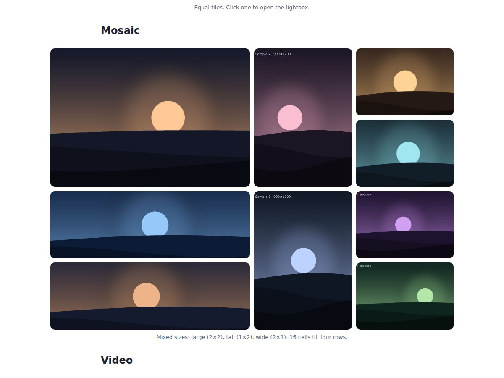

# React media blocks: slider, galleries, lightbox, lazy YouTube, JSON renderer


A proof of concept for rendering rich content stored as **JSON blocks**: text, single images, an image slider, grid and mosaic galleries with a lightbox, and a YouTube embed that loads only when played. No UI library; plain React and one CSS file themed with variables.



## What it demonstrates

- **Content as data:** a page is a list of typed blocks (`p`, `heading`, `quote`, `image`, `gallery`, `youtube`) rendered by a small registry. Unknown types are skipped, so newer content never crashes older code. Text is rendered as text, never as HTML.
- **An accessible slider:** arrows, dots, swipe, ←/→ keys when focused, live “2 / 4” count, and per-slide captions.
- **Grid and mosaic galleries:** mosaic tiles span `wide` (2×1), `tall` (1×2) or `large` (2×2) on a dense CSS grid. A tested helper counts cells and warns in development when a layout would leave a gap.
- **A lightbox:** rendered in a portal; Esc closes, arrows and swipe move, page scroll is locked, and focus returns to the tile that opened it.
- **A YouTube facade:** shows the thumbnail and loads the privacy-enhanced (`youtube-nocookie.com`) player only on click, which keeps pages fast. Accepts any common YouTube URL or a bare ID.
- **Graceful failure:** a missing image shows a placeholder instead of a broken icon; an invalid video link renders nothing.
- **Sizes:** images and galleries can break out of the text column (`normal`, `wide`, `full`).

## Quick start

Requires Node 20+.

```bash
npm install
npm test        # unit tests for the pure helpers
npm run dev     # demo at http://localhost:5173
```

The demo page is generated from [`src/demo/content.json`](src/demo/content.json); expand “View the JSON behind this page” at the bottom.

## Usage

```jsx
import { BlockRenderer } from "./media";

const blocks = [
  { type: "p", text: "Hello." },
  { type: "gallery", layout: "slider", images: [{ src: "/a.jpg", alt: "…" }, { src: "/b.jpg", alt: "…" }] },
  { type: "gallery", layout: "mosaic", columns: 4, images: [{ src: "/c.jpg", alt: "…", span: "large" }] },
  { type: "youtube", video: "https://youtu.be/VIDEO_ID", title: "…" },
];

<BlockRenderer blocks={blocks} />;
```

| Block | Fields |
| --- | --- |
| `p`, `heading`, `quote` | `text` |
| `image` | `src`, `alt`, `caption?`, `size?`: `normal` · `wide` · `full` |
| `gallery` | `layout`: `slider` · `grid` · `mosaic`; `images[]` (`src`, `alt`, `caption?`, `span?`); `columns?` (2–4); `caption?`; slider only: `ratio?`, `fit?` |
| `youtube` | `video` (URL or ID), `title`, `caption?`, `start?` (seconds) |

Set `VITE_MEDIA_BASE_URL` to serve relative image paths from a CDN or bucket; full URLs are used as they are.

**Mosaic tip:** a normal tile is 1 cell, `wide` and `tall` are 2, `large` is 4. For a clean rectangle, make the total a multiple of `columns` and place tall tiles next to small ones.

## Files

| Path | What it is |
| --- | --- |
| `src/media/BlockRenderer.jsx` | Block type → component registry |
| `src/media/ImageSlider.jsx`, `Gallery.jsx`, `Lightbox.jsx` | Image components |
| `src/media/YouTube.jsx` | Click-to-load video |
| `src/media/Img.jsx`, `useSwipe.js` | Lazy image with fallback; touch swipe |
| `src/media/media.js` | Pure helpers: `youtubeId`, `mediaUrl`, `mosaicLayout` (unit-tested) |
| `src/media/media.css` | All styles, themed with `--mb-*` variables |
| `src/demo/` | The demo page and its JSON |

## Limitations

- No responsive `srcset`; serve sensibly sized images (about 2000 px on the long side).
- The mosaic check spots incomplete rows, not every gap a dense grid can leave around tall tiles.
- Component behaviour (slider, lightbox) was verified in a browser; only the pure helpers have automated tests.

## How this was built

Built through AI pair programming with Claude (Anthropic). I defined the requirements and reviewed and tested the result; Claude wrote most of the code.

## License

MIT. Sample images are generated placeholders. The demo video is *Big Buck Bunny* by the Blender Foundation (CC BY 3.0), embedded from YouTube.
