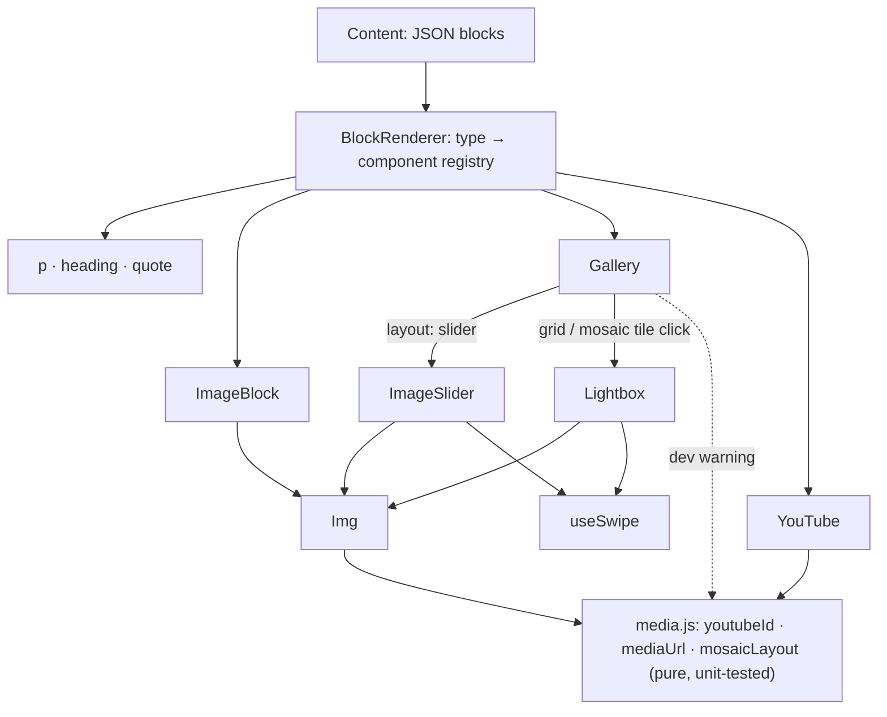

# Architecture

## Structure

## Design patterns

| Pattern | Where | Problem it solves |
| --- | --- | --- |
| **Registry (strategy per type)** | `RENDERERS` in `BlockRenderer.jsx` | Adding a block type is one entry; no growing `switch` spread across files |
| **Tolerant reader** | Unknown block types are skipped | Content written for a newer version doesn’t crash an older client |
| **Composition** | `Gallery` delegates to `ImageSlider` or renders tiles and a `Lightbox` | Small components, each with one job, reused across layouts |
| **Portal** | `Lightbox` renders into `document.body` | A parent’s `overflow` or stacking can’t clip the full-screen viewer |
| **Facade (lazy embed)** | `YouTube` shows a thumbnail first | YouTube’s heavy player loads only for readers who press play |
| **Null object / graceful fallback** | `Img` placeholder; invalid video → nothing | One bad asset doesn’t break the page or show a broken icon |
| **Custom hook** | `useSwipe` | Touch handling shared by the slider and the lightbox |
| **Functional core, thin UI** | `media.js` has no React | The logic most likely to have edge cases is unit-tested without a browser |
| **Theming via CSS custom properties** | `--mb-*` in `media.css` | Restyle without forking the components |

## Key decisions

**Text is text.** Blocks carry plain strings rendered as React text nodes, never `dangerouslySetInnerHTML`, so stored content can’t inject markup.

**Accessibility is built in, not added.** The slider is a focusable region with keyboard control and a live count; tiles are buttons with descriptive labels; the lightbox is a modal dialog that locks scroll, closes on Esc and returns focus to what opened it.

**Strict video parsing.** `youtubeId` parses the URL and checks the host, so `evil.example/watch?v=…` is rejected rather than matched by a loose regular expression.

**Layouts are CSS, not JavaScript.** The mosaic is a dense CSS grid with span classes; JavaScript only counts cells to warn about gaps in development.

## Alternatives considered

| Alternative | Why not here |
| --- | --- |
| Rendering stored HTML | Needs sanitising and gives authors unlimited layout freedom; blocks keep content structured |
| A carousel or lightbox library | Hides exactly the behaviour this repo demonstrates, and adds weight |
| Embedding the YouTube iframe directly | Loads hundreds of KB and third-party scripts on every page view |
| JavaScript masonry layout | CSS grid handles mixed spans without measuring the DOM |
